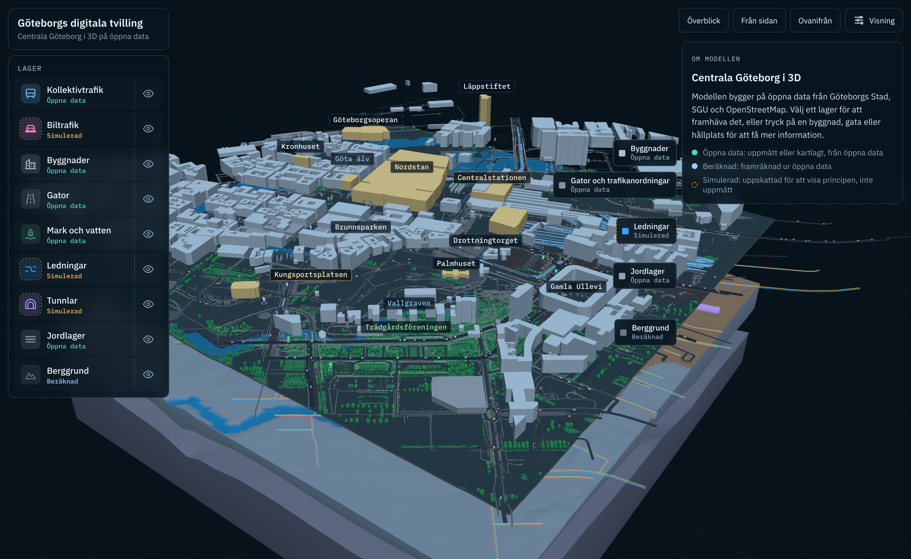
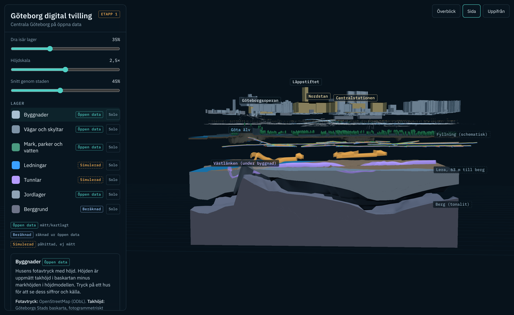

# Göteborg Digital Tvilling

En interaktiv 3D-modell av centrala Göteborg (1,5 × 1,5 km kring Centralstationen, Nordstan, Trädgårdsföreningen och Kungsportsplatsen) byggd på öppna data. Lagren går att dra isär, och man kan snitta genom staden ner till berget.




## Status: etapp 1, riktig stad

- 677 hus med riktiga fotavtryck. 457 har höjd beräknad ur baskartans uppmätta takkonturer minus höjdmodellen. Tryck på ett hus för att se dess siffror och källa.
- Markyta från laserskannad höjdmodell (4 m rutnät), vatten, parker, 2 136 uppmätta träd.
- Gator, kantsten och spårvagnsspår i 3D, 1 845 belysningsstolpar, 300 trafiksignaler och skyltar.
- Jordlager och berg från SGU: över 100 m lera vid Centralen och berg i dagen vid Kronhuset.
- Tunnlar (Götatunneln, Västlänken) och ledningar visas men är **simulerade**, och märkta så.
- **Lagerväljare** som alltid syns: en lista till vänster på dator och en rad längst ner på telefon. Ett tryck sätter lagret i fokus och tonar ned övriga lager. Ögat döljer lagret.
- **Lagerskyltar** vid sidan av modellen när lagren är isärdragna. Skyltarna går också att trycka på.
- **Infokort** med fast plats: till höger på dator och ovanför lagerraden på telefon.
- **Visning:** dra isär lagren, snitt, överhöjning, "Visa endast öppna data", namn i modellen och kameravyer.
- **Tryck på allt:** hus, gator, hållplatser, bilar, ledningar, tunnlar, träd, skyltar, mark, vatten, jord och berg ger ett kort infokort. Varje värde har en prick för källa, och "Visa detaljer" visar exakta siffror och källtext.
- **Etiketter i tre zoomnivåer:** landmärken i överblick, gatunamn, torg och hållplatser på kvartersnivå, husnamn och adresser på nära håll.
- **Kollektivtrafik:** 19 hållplatser med spårvagns- och busslinjer (OSM).
- **Biltrafik (simulerad):** bilar kör på det verkliga gatunätet med riktning och hastighetsgräns från OSM. Antalet följer en typisk dygnsprofil.
- Acceptanskontroll: [docs/acceptans.md](docs/acceptans.md). Sju landmärken ligger inom 1 m från baskartan.

## Teknikval: Three.js i stället för CesiumJS

Handoveren föreslog CesiumJS. Jag valde Three.js med ett lokalt metriskt koordinatsystem (SWEREF 99 12 00):
- "Dra isär lager" och "Snitt" blir enkla: varje lager är en grupp som flyttas i höjdled, och snittet är ett klipp-plan. På en glob i Cesium skulle båda kräva omvägar.
- Plattan med jord och berg är en egen blockmodell. Någon globterräng eller underjordsvy behövs inte.
- Området är litet, så hela modellen ryms i cirka 5 MB förprocessade filer och går snabbt på telefon. Ingen Cesium ion-nyckel behövs.

Om tvillingen senare ska täcka hela staden eller använda 3D Tiles är Cesium värt att pröva igen.

## Kom igång

```bash
npm install
npm run dev          # http://localhost:5173
npm run build        # statisk sajt i dist/
```

Förprocessad data ligger i `public/data/`. Så här bygger du om den från källorna:

```bash
npm run data:fetch   # baskarta (~700 MB), höjdmodell (~580 MB), OSM -> data-raw/
npm run data:sgu     # SGU via WMS
npm run data:build   # -> public/data/ (buildings.glb, roads.glb, terrain.bin, scene.json)
npm run data:accept  # acceptanskontroll
```

## Publicering

`.github/workflows/pages.yml` bygger och publicerar till GitHub Pages vid push till `main`. Det kräver en engångsinställning: Settings → Pages → Source: **GitHub Actions**.

## Datakällor och attribution

Detaljer, verifiering och bearbetning finns i [docs/datakallor.md](docs/datakallor.md).

- **Göteborgs Stad**: baskarta och höjdmodell 2022, CC0. Källa: Göteborgs Stad, Stadsbyggnadsförvaltningen.
- **SGU**: jordartskarta 1:25 000, jorddjupsmodell, berggrundskarta 1:50 000, CC0. Källa: Sveriges geologiska undersökning.
- **OpenStreetMap**: © OpenStreetMaps bidragsgivare, ODbL 1.0. Härledda geometrier i `public/data/` omfattas av ODbL.

Koden är skriven för demo hos Stadsmiljöförvaltningen. `prototype/index.html` är den ursprungliga stiliserade konceptprototypen.
