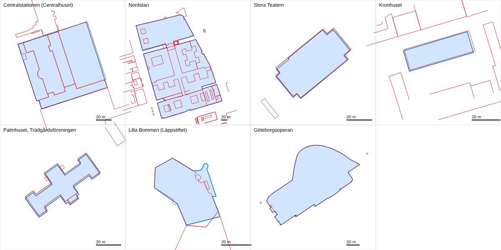

# Acceptans etapp 1: ligger husen rätt?

Krav: jämför minst fem kända byggnader eller hörn mot baskartan eller en satellitkarta.

**Metod** (`npm run data:accept`): modellens fotavtryck kommer från OpenStreetMap. De jämförs mot Göteborgs Stads baskarta, en oberoende fotogrammetrisk inmätning (takkonturer och fasadlinjer). Längs varje fotavtrycks kant tas en punkt per meter, och avståndet till närmaste baskartelinje mäts. Båda källorna räknas om till SWEREF 99 12 00.

| Byggnad | Mittpunkt (WGS84) | Medianavvikelse | 90:e percentil | Höjd i modellen | Höjdkälla |
|---|---|---|---|---|---|
| Centralstationen (Centralhuset) | 57.70924, 11.97289 | 0,34 m | 1,41 m | 18,4 m | Baskartan |
| Nordstan | 57.70855, 11.96937 | 0,35 m | 1,05 m | 20,8 m | Baskartan |
| Stora Teatern | 57.70261, 11.97072 | 0,31 m | 0,72 m | 14,1 m | Baskartan |
| Kronhuset | 57.70786, 11.96356 | 0,70 m | 1,28 m | 20,2 m | OSM våningar (6) |
| Palmhuset, Trädgårdsföreningen | 57.70555, 11.97582 | 0,81 m | 1,10 m | 4,0 m | Baskartan |
| Lilla Bommen (Läppstiftet) | 57.71336, 11.96748 | 0,21 m | 4,57 m | 71,1 m | Baskartan |
| Göteborgsoperan | 57.71066, 11.96317 | 0,01 m | 0,05 m | 15,5 m | Baskartan |

**Resultat:** alla sju ligger rätt, med medianavvikelse under 1 m. Avvikelserna motsvarar skillnaden mellan takfot (baskartan) och fasad (OSM).

**Kända begränsningar i höjderna:**
- Läppstiftet får 71 m, takkonturens höjd. Den kända höjden 86 m inkluderar toppen, som inte är en takkontur.
- Palmhuset får 4 m eftersom glastakets konturer mest ligger vid takfoten. Välvda tak och kupoler blir för låga.
- Varje hus får en enda höjd i v1. Hus med flera höjder, till exempel Nordstan med lägre och högre delar, förenklas.
